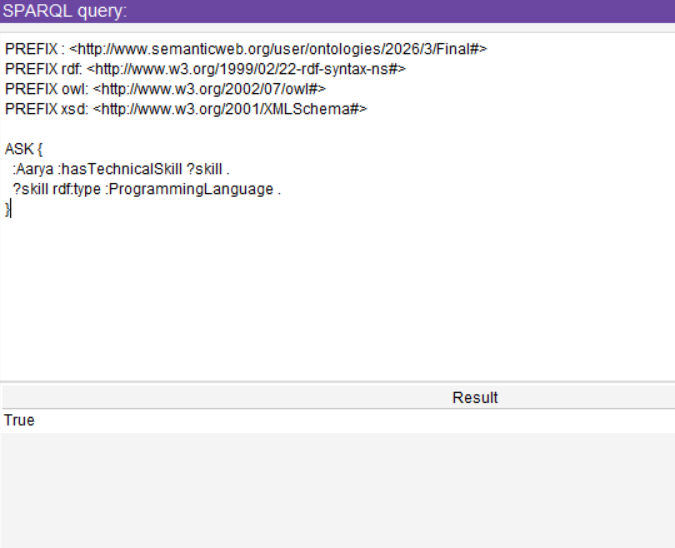
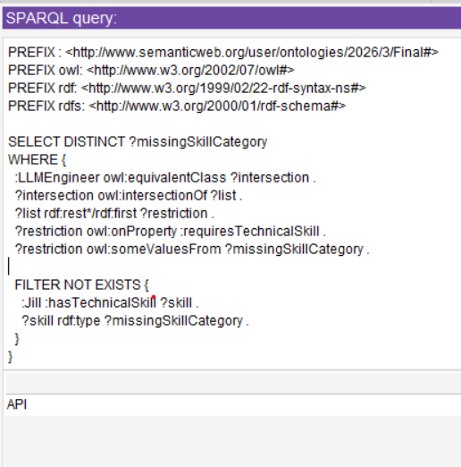
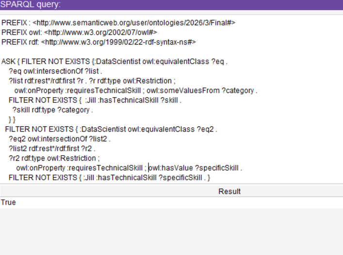

# Candidate-Role Qualification Ontology

## Overview

This ontology provides a structured, logical framework for matching candidates to job roles in Computer Science based on their skills and experience. It is designed to overcome the limitations of keyword-based matching and black-box LLM systems by offering:

- Transparent, explainable reasoning
- Hierarchical skill classification
- Skill-gap detection
- Role-level classification (Junior/Mid/Senior)
- Bias reduction (excludes gender, ethnicity, age)

## Ontology Structure

### Core Classes

| Class | Description |
|-------|-------------|
| Candidate | Job applicant with skills and experience |
| TechnicalSkill | Programming languages, databases, cloud tools, etc. |
| SoftSkill | Communication, teamwork, leadership, etc. |
| Role | Job roles (e.g., DataScientist, LLMEngineer) |
| RoleLevel | Junior, Mid, Senior (based on experience) |

### Key Object Properties

| Property | Domain | Range |
|----------|--------|-------|
| hasTechnicalSkill | Candidate | TechnicalSkill |
| hasSoftSkill | Candidate | SoftSkill |
| requiresTechnicalSkill | Role | TechnicalSkill |
| requiresSoftSkill | Role | SoftSkill |
| qualifiedFor (inferred) | Candidate | Role |

### Key Data Properties

| Property | Domain | Range |
|----------|--------|-------|
| hasYearsOfExperience | Candidate | integer |
| requiresYearsOfExperience | Role | integer |

## Tools Used

| Tool | Purpose |
|------|---------|
| Protégé | Ontology editing and visualization |
| OWL | Ontology language |
| HermiT Reasoner | Logical inference and validation |
| SPARQL | Query execution |

## File Information

| File | Format | Description |
|------|--------|-------------|
| Candidate-role Matching Ontology.owx | OWL/XML | Main ontology (open in Protégé) |
| FINAL.rdf | RDF/XML | Same ontology in RDF/XML |
| sparql/skill_inference.sparql | SPARQL | Skill inference query |
| sparql/missing_skill.sparql | SPARQL | Missing-skill detection query |
| sparql/candidate_role_matching.sparql | SPARQL | Candidate-role matching query |
| images/ | PNG | SPARQL query result screenshots |

## SPARQL Queries

Run these in Protégé (**Window → Tabs → SPARQL Query**) with the ontology loaded. Candidate **Jill** is the main case study.

### 1. Skill inference
Checks whether candidate **Aarya** has a technical skill that is a **ProgrammingLanguage**, using the skill hierarchy. Query: [`sparql/skill_inference.sparql`](sparql/skill_inference.sparql)

**Result:** `True`

### 2. Missing-skill detection
Finds which technical skill categories Jill lacks for the **LLMEngineer** role. Query: [`sparql/missing_skill.sparql`](sparql/missing_skill.sparql)

**Result:** `API`, so Jill needs an API skill to qualify as an LLM Engineer.

### 3. Candidate-role matching
Checks whether Jill meets every technical-skill requirement of **DataScientist**, covering both skill categories (`someValuesFrom`) and specific skills (`hasValue`). Query: [`sparql/candidate_role_matching.sparql`](sparql/candidate_role_matching.sparql)

**Result:** `True`, so Jill is qualified for DataScientist on technical skills.

